# SuperUI · WinForms 标准 UI 库

一套极简、可整体换肤的 WinForms 控件库。当前实现了 **按钮**、**输入框**、**数值输入**、**开关**、**复选框 / 单选按钮**、
**标签**、**进度条**、**下拉框**、**日期选择**、**带复选框的列表**、**树形控件**、**表格**、**分页**、**侧面菜单**、
**遮盖层（Loading 遮罩）**、**消息弹窗（Info / Warning / Error，可整窗压暗）**、**全局主题** 与 **无边框窗口**，
所有颜色/圆角/字体都来自同一份主题，切换主题时已打开的窗口和控件会即时刷新。

**同时支持 .NET Framework 4.8 与 .NET 8（`net48;net8.0-windows` 多目标）**，同一份源码、同一套 API。

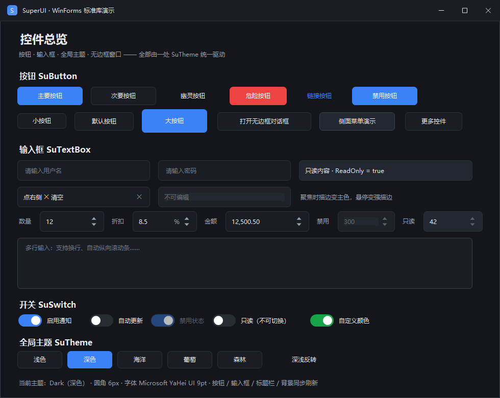

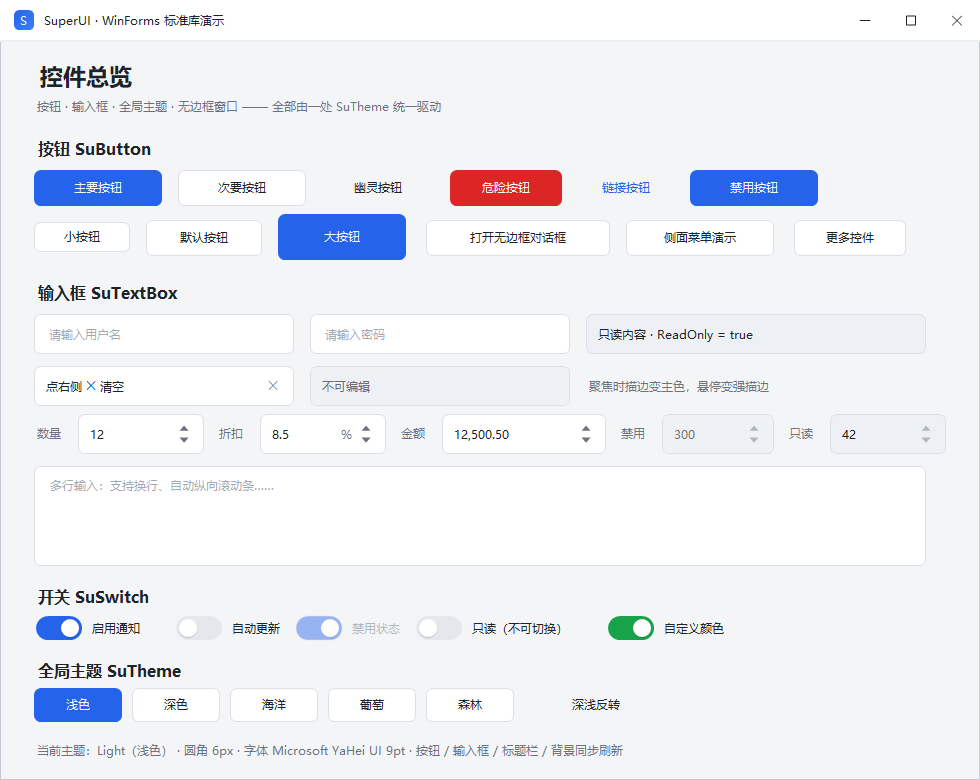

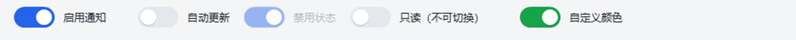


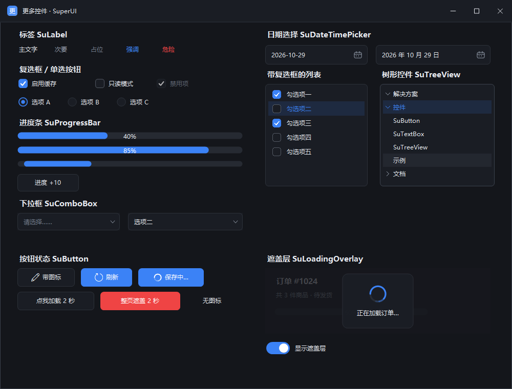

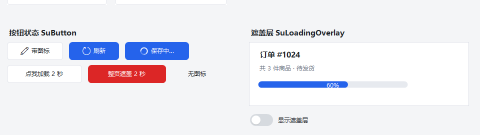

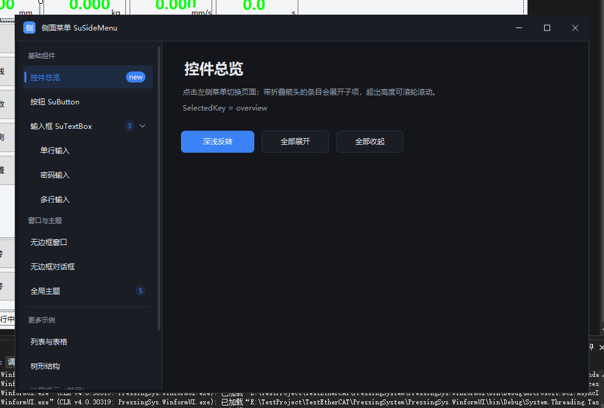

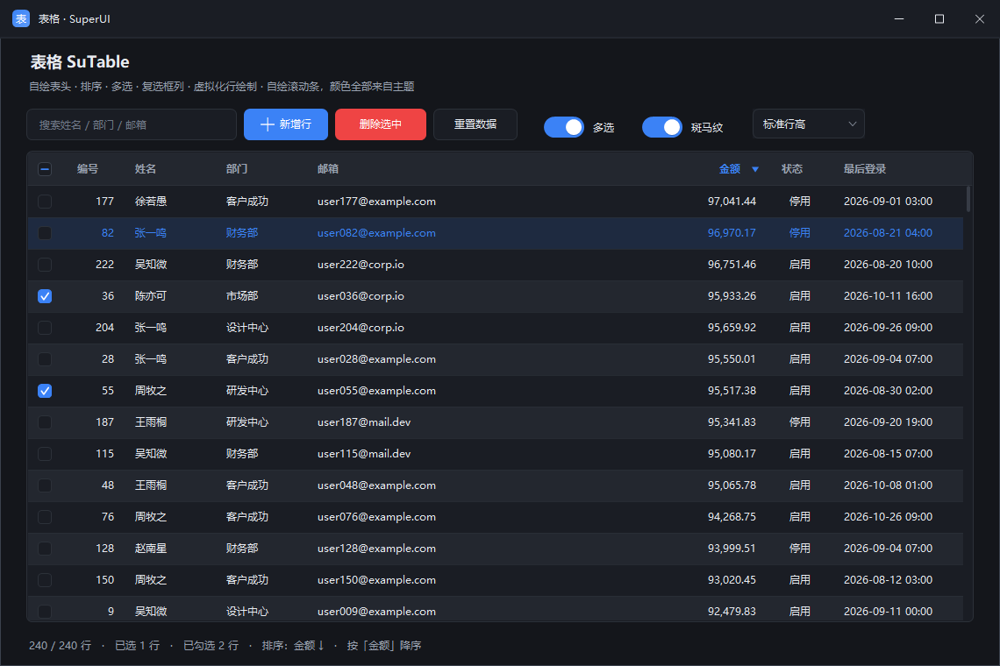

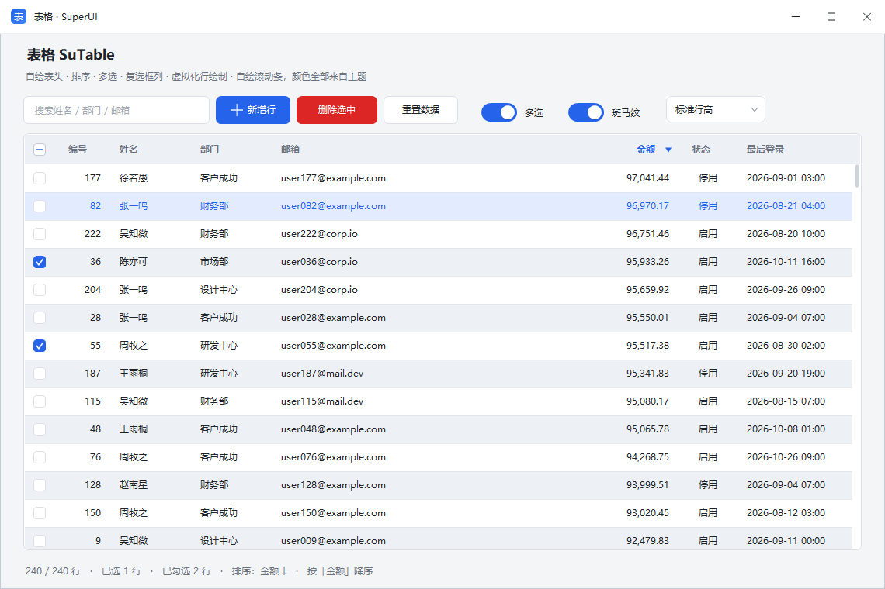

## 解决方案结构

```
SuperUI.sln
├─ src/SuperUI/                 # 类库（net48 + net8.0-windows，其它项目直接引用）
│  ├─ Theming/
│  │  ├─ SuTheme.cs             # 主题定义：颜色 / 圆角 / 字体 / 标题栏度量
│  │  ├─ SuThemePresets.cs      # 内置预设：Light / Dark / Ocean / Grape / Forest
│  │  ├─ SuThemeManager.cs      # 全局主题管理器（弱引用登记 + 广播）
│  │  ├─ ISuThemed.cs           # 订阅接口
│  │  ├─ SuFontSync.cs          # 主题字体同步（用户手动改字体后不再覆盖）
│  │  └─ SuBackdrop.cs          # 解析控件背后的底色
│  ├─ Controls/
│  │  ├─ SuControlBase.cs       # 控件基类：双缓冲、主题订阅、字体
│  │  ├─ SuButton.cs            # 主题按钮
│  │  ├─ SuTextBox.cs           # 主题输入框
│  │  ├─ SuNumericUpDown.cs     # 数值输入框（步进 / 单位 / 夹取）
│  │  ├─ SuSwitch.cs            # 主题开关
│  │  ├─ SuLabel.cs             # 语义色标签
│  │  ├─ SuOptionBase.cs        # 选项类控件基类（复选 / 单选共用）
│  │  ├─ SuCheckBox.cs          # 复选框
│  │  ├─ SuRadioButton.cs       # 单选按钮（同容器互斥）
│  │  ├─ SuProgressBar.cs       # 进度条（含不确定模式）
│  │  ├─ SuComboBox.cs          # 下拉框（自绘字段 + 主题化下拉项）
│  │  ├─ SuDateTimePicker.cs    # 日期选择（自绘字段 + 主题化日历弹层）
│  │  ├─ SuCheckedListBox.cs    # 带复选框的列表框
│  │  ├─ SuTreeView.cs          # 树形控件（全自绘节点）
│  │  ├─ SuTable.cs             # 表格（自绘表头 / 排序 / 多选 / 复选框列 / 虚拟化行）
│  │  ├─ SuPagination.cs        # 分页（页码省略 / 上下页 / 每页条数 / 紧凑模式）
│  │  ├─ SuMenuItem.cs          # 侧边菜单项（数据模型）
│  │  ├─ SuSideMenu.cs          # 侧边导航菜单
│  │  ├─ SuLoadingOverlay.cs    # 遮盖层（Loading 遮罩）
│  │  └─ SuScrimLayer.cs        # 弹窗遮罩层（宿主快照 + 半透明压暗）
│  ├─ Forms/
│  │  ├─ SuTitleBar.cs          # 自绘标题栏
│  │  ├─ SuBorderlessForm.cs    # 无边框窗口
│  │  ├─ SuMessageBoxDialog.cs  # 消息弹窗窗口（语义图标 + 自适应尺寸 + 整窗拖动）
│  │  └─ SuMessageBox.cs        # 消息弹窗静态入口（Info / Warning / Error / Confirm）
│  ├─ Rendering/                # 圆角路径、颜色混合、补间动画、旋转指示器、数值夹取
│  ├─ Compat/                   # net48 缺失的可空性注解补齐
│  └─ Native/                   # Win32 / DWM 互操作
├─ samples/SuperUIDemo/         # 演示台：一个窗口 + 左侧菜单切换所有演示页
└─ tools/
   ├─ capture.ps1               # 截图小工具（开发自测用）
   ├─ window-shot.ps1           # 单窗口截图
   └─ snap-test.ps1             # 无边框窗口拖动手势验收（真实鼠标输入驱动）
```

## 运行演示

演示程序是一台**单窗口演示台**：左边 `SuSideMenu` 列页面，右边内容区切换，底部一排主题预设随时换肤。

```powershell
dotnet run --project samples/SuperUIDemo                              # 默认深色（net8），停在「控件总览」
dotnet run --project samples/SuperUIDemo -- --theme=Light
dotnet run --project samples/SuperUIDemo -- --page=table              # 启动即停在某一页（overview / gallery / table / menu）
dotnet run --project samples/SuperUIDemo -- --dialog                  # 启动即打开无边框对话框
dotnet run --project samples/SuperUIDemo -- --titlebar=62             # 自定义标题栏高度
dotnet run --project samples/SuperUIDemo -- --menu                    # = --page=menu（侧面菜单页）
dotnet run --project samples/SuperUIDemo -- --gallery                 # = --page=gallery（第二批控件页）
dotnet run --project samples/SuperUIDemo -- --table                   # = --page=table（搜索 / 排序 / 多选 / 行高）
dotnet run --project samples/SuperUIDemo -- --table --showcase        # 表格页，预先排好序并选中/勾选几行
dotnet run --project samples/SuperUIDemo -- --pagination              # 分页页（表格 + 分页联动）
dotnet run --project samples/SuperUIDemo -- --messagebox              # 消息弹窗页（Info / Warning / Error）
dotnet run --project samples/SuperUIDemo -- --msgbox                  # 启动即弹一个模态消息框（居中的父窗口）
dotnet run --project samples/SuperUIDemo -f net48                     # 同一程序跑在 .NET Framework 4.8 上

# 冒烟自检：主题 / 布局 / 标题栏 / 最大化边界 / 页面切换 / 侧边菜单 / 开关 / 数值 / 选项 / 加载态 / 演示页 / 表格 / 分页 / 消息弹窗 / 对话框，结果写入 exe 目录 superui-selftest.log
dotnet run --project samples/SuperUIDemo -- --selftest

# 拖动手势验收：真实鼠标拖动，检查触顶最大化 / 左右半屏 / 拖下还原 / 双击标题栏 / 边缘缩放
powershell -NoProfile -ExecutionPolicy Bypass -File tools/snap-test.ps1
powershell -NoProfile -ExecutionPolicy Bypass -File tools/snap-test.ps1 -Exe samples\SuperUIDemo\bin\Debug\net48\SuperUIDemo.exe
```

## 演示台：一个窗口装下所有演示

全部演示都在同一个窗口里，靠菜单切页，不再一人一个窗口：

| 页面 | 内容 | `--page=` |
| --- | --- | --- |
| 控件总览 | 按钮 / 输入框 / 数值 / 开关 / 主题预设 | `overview` |
| 更多控件 | Label、复选、单选、进度条、下拉框、日期、复选列表、树、加载态与遮盖层 | `gallery` |
| 表格 SuTable | 240 行数据，搜索、排序、多选、复选列、行高、滚动 | `table` |
| 分页 SuPagination | 表格 + 分页联动：翻页、每页条数、首末页、紧凑模式 | `pagination` |
| 消息弹窗 SuMessageBox | Info / Warning / Error、确定取消、是/否、长文本换行、异常弹窗、遮罩开关 | `messagebox` |
| 侧面菜单 | 页面内再放一份 `SuSideMenu`，演示分组 / 折叠子项 / 徽标 / 禁用项 | `menu` |

结构就两层：`DemoShellForm`（无边框窗口 + 左侧菜单 + 内容区）和 `DemoPage`（一页一块画布）。

```csharp
// 每一页 = 一个 DemoPage：自己建控件，主题切换时刷新自己的 Label
public sealed class TablePage : DemoPage
{
    public override string PageTitle => "表格 SuTable";     // 菜单与标题栏上显示的名字
    protected override bool Scrollable => false;            // 表格自己铺满，不要外层滚动条

    public TablePage(bool showcase = false)
    {
        BuildUi();                                          // 这一页原来的排布代码
        OnPageThemeChanged();                               // 套上当前主题
    }

    protected override void OnPageThemeChanged()
    {
        var theme = Theme;                                  // SuThemeManager.Current
        _title.Font = DemoFonts.Get(theme, 13f, FontStyle.Bold);
        _title.ForeColor = theme.TextPrimary;
    }
}
```

```csharp
// 外壳：左侧菜单挂 key，内容区按需创建页面（第一次进入时创建，之后保留状态）
var shell = new DemoShellForm();        // SuBorderlessForm
shell.NavigateTo("table");              // 代码切页；菜单选中项会同步
Application.Run(shell);
```

要点：

* 页面 `Dock = Fill` 进内容区，`AutoScroll` 由页面的 `Scrollable` 决定；内容比窗口宽时自动出滚动条，不会把窗口撑大。
* 第一次进入才创建页面，之后只切 `Visible`，所以表格的筛选、选中、勾选都保留着。
* 切页时 `Form.Text` 跟着改成页面名（标题栏文字 = `Form.Text`），左侧菜单选中项与 `CurrentKey` 三处同步。
* 页码参数 `--page=` 与菜单用的是同一套 key，启动直接落到某一页。

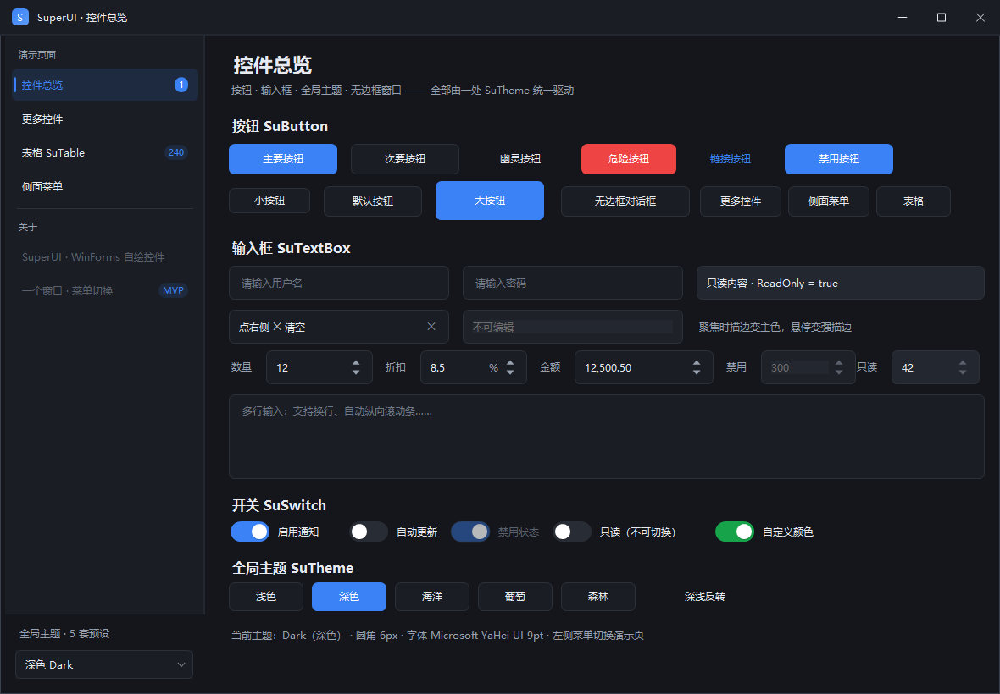

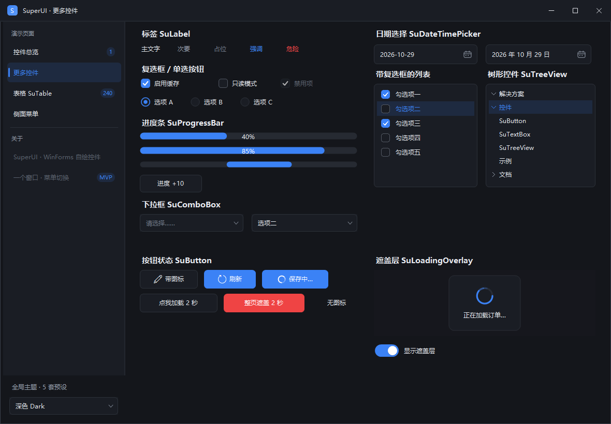

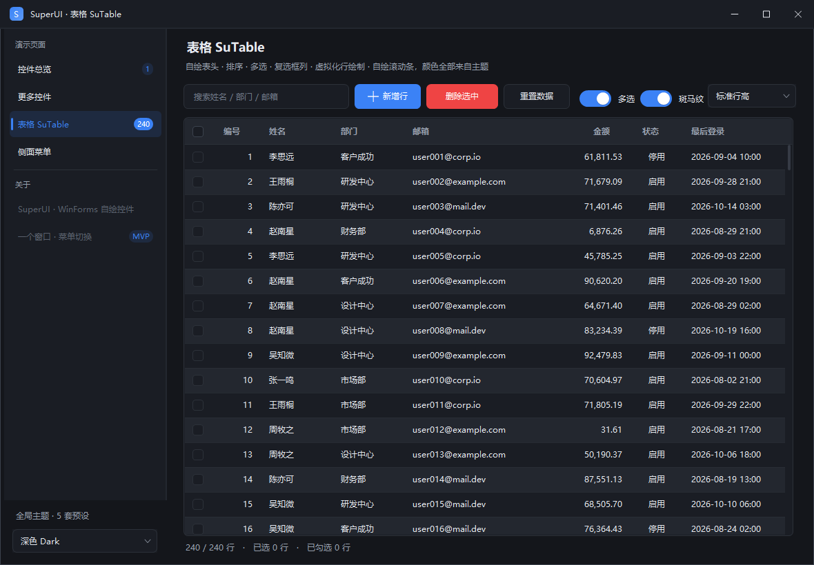


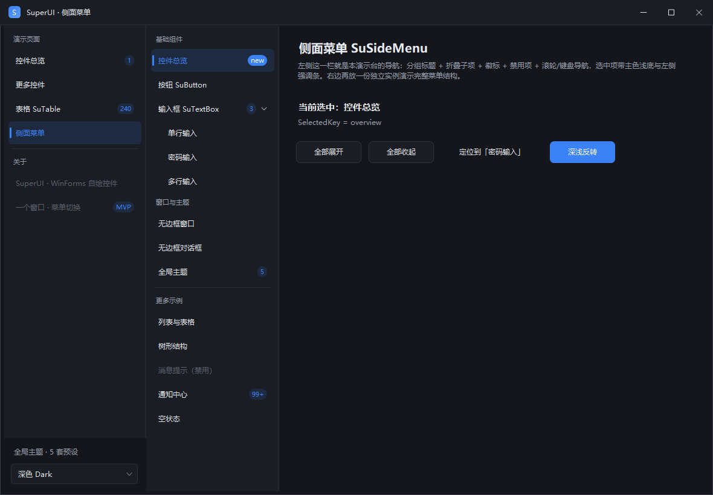

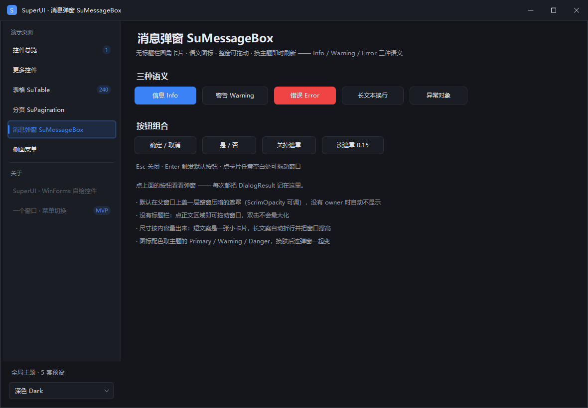

## 在 .NET Framework 4.8 项目里使用

`.NET Framework 4.8` 上运行的效果（同一份演示程序、同一套代码）：

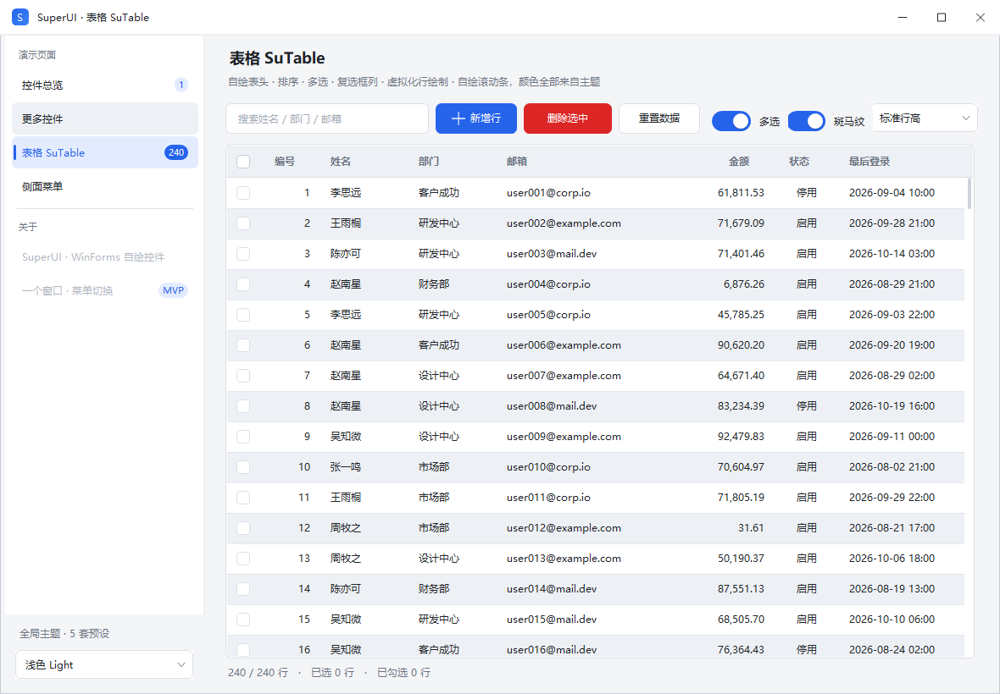

类库是多目标的，直接引用即可（项目引用会自动挑对 `net48` 或 `net8.0-windows`）：

```xml
<Project Sdk="Microsoft.NET.Sdk">
  <PropertyGroup>
    <TargetFramework>net48</TargetFramework>
    <OutputType>WinExe</OutputType>
    <LangVersion>latest</LangVersion>
  </PropertyGroup>

  <ItemGroup>
    <Reference Include="System.Windows.Forms" />
    <Reference Include="System.Drawing" />
    <ProjectReference Include="..\src\SuperUI\SuperUI.csproj" />
  </ItemGroup>
</Project>
```

两点要注意：

1. **高 DPI**：.NET Framework 没有 `Application.SetHighDpiMode`，用 `App.config` 打开：

   ```xml
   <configuration>
     <System.Windows.Forms.ApplicationConfigurationSection>
       <add key="DpiAwareness" value="PerMonitorV2" />
       <add key="EnableWindowsFormsHighDpiAutoResizing" value="true" />
     </System.Windows.Forms.ApplicationConfigurationSection>
   </configuration>
   ```

2. **C# 语言版本**：源码用到 `switch` 表达式、`is not null`、`??=` 等语法，
   在 net48 上需要 `<LangVersion>latest</LangVersion>`（用新版编译器编译老框架即可，不需要新运行时）。

镜像实现已经做过这些兼容处理：

| 差异 | 处理方式 |
| --- | --- |
| 没有 `Math.Clamp` | `Rendering/SuMath.cs` 提供同语义的 `SuMath.Clamp` |
| 没有 `ArgumentNullException.ThrowIfNull` | 改为显式 `if (x is null) throw` |
| 没有 `System.Range` / `Index` | 字符串切片改用 `Substring` |
| 没有 `AllowNullAttribute` | `Compat/NullableAttributes.cs` 中 `#if NETFRAMEWORK` 补齐 |
| `record struct` 需要 `IsExternalInit` | 内部颜色结构体改为普通 `readonly struct` |
| `int` → `IntPtr` 无隐式转换 | 消息返回处显式 `(IntPtr)` 强转 |

`DllImport`（user32 / dwmapi）与 `DeviceDpi`、`WM_NCHITTEST` 等在 4.8 上同样可用，无边框窗口的行为完全一致。

## 一、主题：一处设置，整站生效

```csharp
using SuperUI.Theming;

// 1) 启动时选一个预设（必须在创建窗口之前）
SuThemeManager.Apply(SuThemePresets.Dark);

// 2) 运行时随时切换，已打开的窗口/控件自动刷新
SuThemeManager.Apply("Ocean");          // 按名称
SuThemeManager.Apply(SuThemePresets.Grape);
SuThemeManager.SetDark(true);
SuThemeManager.ToggleLightDark();       // 在 Light / Dark 之间反转

// 3) 基于预设派生自定义主题
var brand = SuThemePresets.Light.Clone();
brand.Name = "Brand";
brand.Primary = Color.FromArgb(0xE1, 0x3B, 0x2C);
brand.PrimaryHover = Color.FromArgb(0xF0, 0x55, 0x46);
brand.PrimaryPressed = Color.FromArgb(0xC1, 0x2E, 0x21);
brand.Radius = 10;
SuThemeManager.Apply(brand);
```

`SuTheme` 的主要属性：

| 分组 | 属性 |
| --- | --- |
| 背景/表面 | `Background`、`Surface`、`SurfaceAlt`、`Border`、`BorderStrong` |
| 文字 | `TextPrimary`、`TextSecondary`、`TextPlaceholder`、`TextDisabled`、`TextOnAccent` |
| 主色 | `Primary`、`PrimaryHover`、`PrimaryPressed`、`PrimaryDisabled`、`PrimarySoft`、`FocusRing` |
| 危险色 | `Danger`、`DangerHover`、`DangerPressed`、`Warning`（警告/琥珀） |
| 标题栏 | `TitleBarBackground`、`TitleBarText`、`CaptionHover`、`CaptionCloseHover`、`TitleBarHeight` |
| 度量 | `Radius`（默认圆角）、`FontFamily`、`FontSize`、`IsDark` |

普通控件（`Label`、`Panel` 等）不会自动换肤，可以订阅事件手动同步：

```csharp
SuThemeManager.ThemeChanged += (_, _) =>
{
    var theme = SuThemeManager.Current;
    myLabel.ForeColor = theme.TextPrimary;
    myPanel.BackColor = theme.Background;
};
```

## 二、按钮 SuButton

```csharp
var ok = new SuButton
{
    Text = "确定",
    Variant = SuButtonVariant.Primary,   // Primary / Secondary / Ghost / Danger / Link
    Bounds = new Rectangle(24, 24, 120, 38),
    DialogResult = DialogResult.OK,
};
Controls.Add(ok);
```

* 完全自绘：圆角、悬停/按下缓动、聚焦光环、`Image` + 文字排版、`TextAlign`、禁用态。
* 颜色全部来自主题，因此同一份代码在任意主题下都成立。
* `Radius = -1` 跟随主题圆角，指定正数可单独设定。
* `Ghost` / `Link` 用「父容器底色」填充（`BackdropColor` 可手动指定），不依赖 WinForms 透明背景。

**图标**：三种来源，优先级 `Icon`（图片）→ `IconGlyph`（图标字体字形）→ 原生 `Image`。

```csharp
var refresh = new SuButton
{
    Text = "刷新",
    Variant = SuButtonVariant.Primary,
    IconGlyph = "\uE72C",     // Segoe MDL2 Assets 的刷新图标（不必再设 IconSize）
};
```

> **没有图标就不占位**：只有确实要画东西时才预留图标槽位——`Icon` / `Image` 为空、`IconGlyph` 为空、
> 或者字形字体不可用 / 该字形宽度为 0 时，文字直接居中，不会留一块空白。
> 图片图标按原比例缩放居中，不会被拉伸变形。

**加载态**：`IsLoading = true` 时按钮左侧换成旋转指示器、屏蔽点击（`Click` / `DialogResult` 都不会触发），
外观保持正常态不置灰；`LoadingText` 可临时替换文字。

```csharp
saveButton.LoadingText = "保存中…";
saveButton.IsLoading = true;     // 期间 PerformClick() 也不会触发 Click
// ... 异步完成后
saveButton.IsLoading = false;
```

| 属性 | 默认 | 说明 |
| --- | --- | --- |
| `Icon` / `IconGlyph` / `IconFont` | `null` / `null` / `Segoe MDL2 Assets` | 图标图片 / 字形 / 字形字体 |
| `IconSize` / `IconGap` | `16` / `6` | 图标边长 / 与文字间距（无图标时不生效） |
| `IsLoading` / `LoadingText` | `false` / `null` | 加载态 / 加载态文字 |


## 三、输入框 SuTextBox

```csharp
var name = new SuTextBox
{
    PlaceholderText = "请输入用户名",
    Bounds = new Rectangle(24, 80, 260, 40),
    AutoHeight = false,          // 需要固定高度时关掉自动高度
    ShowClearButton = true,      // 右侧 ✕ 一键清空
};

var pwd = new SuTextBox { PlaceholderText = "请输入密码", UseSystemPasswordChar = true };
var memo = new SuTextBox { Multiline = true, PlaceholderText = "备注……" };

string text = name.Text;
name.TextChanged += (_, _) => { /* ... */ };
```

| 属性 | 说明 |
| --- | --- |
| `Text` | 输入内容（与内部 `TextBox` 双向同步，`TextChanged` 正常触发） |
| `PlaceholderText` | 占位提示；为空且未聚焦时显示，聚焦后隐藏把位置让给光标 |
| `Multiline` / `ReadOnly` / `Enabled` | 多行、只读、禁用（各自有对应配色） |
| `ShowClearButton` | 显示清除按钮 |
| `PasswordChar` / `UseSystemPasswordChar` / `MaxLength` | 密码与长度限制 |
| `Radius` / `AutoHeight` / `PreferredHeight` | 圆角与高度控制 |
| `SelectAll()` / `Clear()` / `Focus()` / `SelectionStart` / `SelectionLength` | 常用操作 |

输入框自带聚焦高亮：聚焦时描边过渡到主色并叠加一圈半透明光环，失焦回落。

## 四、无边框窗口 SuBorderlessForm

窗体**本身就是设计画布**：控件可以直接从工具箱拖到窗体上，也可以 `Controls.Add`。
标题栏和四周缩放热区通过重写 `DisplayRectangle` 预留，内容永远不会压到标题栏上。

```csharp
public sealed class MyForm : SuBorderlessForm
{
    public MyForm()
    {
        Text = "我的应用";                       // 标题栏文字 = Form.Text
        ClientSize = new Size(1000, 700);
        MinimumSize = new Size(860, 600);
        TitleBarHeight = 48;                     // 标题栏高度；-1 = 跟随主题

        // 方式一：代码排布。用 DisplayRectangle 的原点定位，自动避开标题栏与缩放热区
        var origin = DisplayRectangle;
        var ok = new SuButton
        {
            Text = "确定",
            Variant = SuButtonVariant.Primary,
            Bounds = new Rectangle(origin.X + 24, origin.Y + 24, 120, 38),
        };
        Controls.Add(ok);

        // 方式二：停靠/锚定。Dock = Fill 正好铺满 DisplayRectangle（标题栏以下、缩放热区以内）
        var list = new ListBox { Dock = DockStyle.Fill };
        Controls.Add(list);
    }
}
```

设计器里也可以直接拖控件：

* 拖到窗体上的控件父级就是窗体本身，设计时就能看到标题栏与真实内容区。
* 位置由你拖放决定（`Location` 是客户区坐标）；想让它随窗口缩放，用 `Dock` / `Anchor`，
  它们都以 `DisplayRectangle`（已扣除标题栏与缩放热区）为基准，不会跑到标题栏里。
* 想给内容统一加内边距，直接设窗体的 `Padding`，它会在 `DisplayRectangle` 里再缩一圈。

特性：

* 自绘标题栏：Logo（无图时用主色方块 + 首字）、标题、最小化 / 最大化（最大化后变还原图标）/ 关闭，关闭按钮悬停变红。
* 拖动与 Aero Snap：按下标题栏时**临时**给窗口挂上 `WS_THICKFRAME`（不触发边框重算，客户区大小和外观都不变），
  再把 `WM_NCLBUTTONDOWN + HTCAPTION` 交给窗体走系统原生移动循环。于是这些手势全部可用：

  * **拖到屏幕顶部松手即最大化**，最大化区域正好是工作区（不盖任务栏，客户区满幅，没有多出来的系统边框条）；
  * 拖到左右两侧 → 半屏；拖到四角 → 四分之一屏（都按工作区算，逐屏生效）；
  * 最大化后按住标题栏往下拖 → 系统原样还原并跟随鼠标；
  * 双击标题栏空白处 → 最大化 / 还原（第一次按下会让系统进入模态移动循环，第二次点击收不到
    `WM_LBUTTONDBLCLK`，所以双击由 `SuTitleBar` 自己按系统双击时间与距离判定）；
  * 松手后立刻摘掉 `WS_THICKFRAME`，窗口依旧是无边框、满幅客户区的样子。

  窗口设了 `ShowMaximizeBox = false` 时不会触顶最大化，但左右半屏照旧；`Resizable = false` 时整套吸附关闭。
* 八方向缩放：四周预留 `ResizeBorderThickness`（默认 6px，按 DPI 缩放）的自绘热区做命中测试，光标准确变成缩放箭头。
* 最大化贴合工作区：拦截 `WM_GETMINMAXINFO`，不会盖住任务栏，也不会溢出屏幕。
* 圆角与投影：`RoundedCorners`（Windows 11 DWM 圆角）、`UseDwmShadow`（补系统投影）。
* 主题联动：窗口底色、外框、标题栏、按钮随主题切换即时刷新。

常用属性：

| 属性 | 默认 | 说明 |
| --- | --- | --- |
| `DisplayRectangle` | — | 内容可用矩形：客户区 − 标题栏 − 四周缩放热区 − `Padding` |
| `TitleBarHeight` | `-1` | 标题栏高度，`-1` 跟随主题的 `TitleBarHeight` |
| `TitleBar` | — | 标题栏实例，可追加自定义控件 / 换 Logo / 调 `CaptionButtonWidth` |
| `ShowMinimizeBox` / `ShowMaximizeBox` / `ShowCloseBox` | `true` | 窗口按钮显隐 |
| `TitleBarVisible` | `true` | 是否显示标题栏 |
| `Resizable` | `true` | 是否允许缩放（`false` 时锁定尺寸） |
| `ResizeBorderThickness` | `6` | 缩放热区宽度 |
| `RoundedCorners` / `UseDwmShadow` | `true` | 系统圆角 / 投影 |

无边框对话框：直接继承，设置固定尺寸与按钮显隐即可。

```csharp
var dialog = new DemoDialog            // : SuBorderlessForm
{
    ShowMinimizeBox = false,
    ShowMaximizeBox = false,
    Resizable = false,
};
dialog.ShowDialog(this);
```

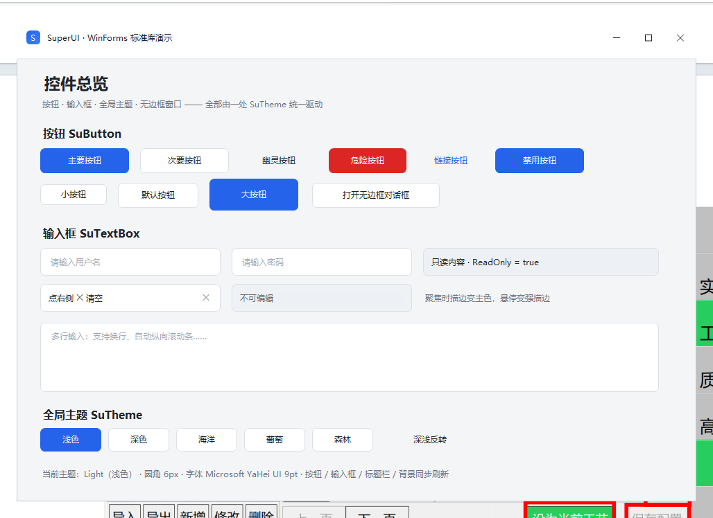

## 五、侧面菜单 SuSideMenu

```csharp
var menu = new SuSideMenu
{
    Dock = DockStyle.Left,
    Width = 236,
    // ItemHeight = 40, GroupHeaderHeight = 30, Indent = 16, PanelColor = null（跟随主题 Surface）
};
Controls.Add(menu);

menu.AddGroup("基础组件");

var overview = menu.Add(new SuMenuItem("控件总览") { Key = "overview", Badge = "new" });
menu.Add(new SuMenuItem("按钮 SuButton") { Key = "button", Glyph = "\uE8A5" });   // 图标字体字形

var input = menu.Add(new SuMenuItem("输入框 SuTextBox") { Key = "input", Badge = "3" });
input.Add(new SuMenuItem("单行输入") { Key = "input-single" });
input.Add(new SuMenuItem("多行输入") { Key = "input-multiline" });
input.IsExpanded = true;

menu.AddSeparator();
menu.AddGroup("更多");
menu.Add(new SuMenuItem("通知中心") { Key = "notify", Badge = "99+" });

menu.SelectedItem = overview;
menu.SelectedItemChanged += (_, _) => ShowPage(menu.SelectedKey);
menu.ItemClick += (_, e) => Debug.WriteLine($"click: {e.Item.Key}");
```

能力清单：

* **纵向导航**：分组标题（`AddGroup`）、分隔线（`AddSeparator`）、多级子项（`Children` / `Add`）。
* **选中态**：主色浅底 + 左侧 3px 强调条 + 主色文字，选中子项会自动展开父项。
* **悬停缓动**：条目悬停淡入，`Cursor` 自动变手型；禁用项不可点、文字转灰。
* **徽标**：`Badge = "new" / "3" / "99+"`，选中时自动反色。
* **图标**：`Icon`（`Image`）或 `Glyph`（图标字体字形，配 `IconFont`，默认 Segoe MDL2 Assets）。
* **滚动**：内容超出高度时右侧出现细滚动条（自绘，不是系统滚动条），支持滚轮；
  `SelectedItem` 赋值时会自动滚动到可见位置。
* **键盘**：`↑ ↓` 移动选中，`← →` 收起/展开，`Home / End` 跳首尾，`Enter / Space` 触发 `ItemClick`。
* **代码友好**：`Add(string)`、`SelectByKey("input-single")`、`ExpandAll()`、`CollapseAll()`、`Item.Find("…")`。

主要属性：

| 属性 | 默认 | 说明 |
| --- | --- | --- |
| `Items` | 空 | 顶级菜单项集合 |
| `SelectedItem` / `SelectedKey` | `null` | 当前选中项 / 其 Key |
| `ItemHeight` / `GroupHeaderHeight` / `SeparatorHeight` | `40` / `30` / `13` | 三类条目的高度 |
| `Indent` | `16` | 每级子项缩进 |
| `PanelColor` | `null` | 菜单底色，`null` = 主题 `Surface` |
| `IconFont` | `Segoe MDL2 Assets` | `Glyph` 所用字体 |
| `ShowRightBorder` | `true` | 右侧 1px 分隔线 |

事件：`SelectedItemChanged`、`ItemClick`（`SuMenuItemEventArgs.Item` 是具体菜单项）。

> `SuMenuItem` 的 `Text / Badge / Icon / IsExpanded / Enabled` 都是运行时可改的，
> 改动会自动冒泡通知菜单重绘（可以拿它做未读数、展开状态等动态更新）。

## 六、开关 SuSwitch

```csharp
var autoUpdate = new SuSwitch
{
    Text = "自动更新",          // 文字标签（可空），默认在开关右侧
    Checked = true,
    Location = new Point(origin.X + 24, origin.Y + 24),
};
Controls.Add(autoUpdate);

autoUpdate.CheckedChanged += (_, _) => Apply(autoUpdate.Checked);
```

能力：

* **动画**：轨道颜色与圆钮位置都走 150ms 缓动（`SuTween`），不是硬切。
* **自动尺寸**：按文本 + 轨道尺寸算 `PreferredSize`，`Text`/字体/`TrackWidth` 变化后自动重排。
* **状态齐全**：`Checked`、`ReadOnly`（可聚焦但点不动）、`Enabled = false`（整体转灰、圆钮变淡）三种外观。
* **交互**：鼠标点击切换（手型光标 + 悬停微调色）、`Space` 键切换、`Tab` 聚焦后显示主色光环；
  `AccessibleRole = CheckButton`、`AccessibleName` 跟随文本。
* **颜色可覆盖**：`OnColor`（开）、`OffColor`（关）、`KnobColor`（圆钮），留空则从主题推导。
* **主题联动**：开=主色、关=中性灰、圆钮=反白，换主题即时刷新。

| 属性 | 默认 | 说明 |
| --- | --- | --- |
| `Checked` | `false` | 开关状态，变化触发 `CheckedChanged` |
| `Text` | `""` | 文字标签（也作为可访问性名称） |
| `LabelOnLeft` | `false` | 标签放在左侧 |
| `LabelGap` | `10` | 标签与轨道的间距 |
| `TrackWidth` / `TrackHeight` | `46` / `24` | 轨道尺寸（圆钮大小由 `TrackHeight` 推导） |
| `KnobInset` | `3` | 圆钮相对轨道的内边距 |
| `ReadOnly` | `false` | 只读：不响应点击 / 空格 |
| `OnColor` / `OffColor` / `KnobColor` | `null` | 自定义配色，`null` 表示跟随主题 |

## 七、数值输入 SuNumericUpDown

```csharp
var qty = new SuNumericUpDown
{
    Minimum = 0m,
    Maximum = 999m,
    Increment = 5m,
    Value = 12m,
    AutoHeight = false,
    Bounds = new Rectangle(origin.X + 24, origin.Y + 24, 160, 40),
};
Controls.Add(qty);

qty.ValueChanged += (_, _) => Apply(qty.Value);

// 带小数、单位与千位分隔符
var amount = new SuNumericUpDown
{
    Minimum = 0m,
    Maximum = 1_000_000m,
    Increment = 100m,
    DecimalPlaces = 2,
    ThousandsSeparator = true,
    Unit = "元",
    Value = 12500.5m,
};
```

能力：

* **自绘外框与步进按钮**：圆角描边、聚焦主色高亮 + 光环、悬停强描边，右侧两个三角形步进按钮（悬停/按下有底色，到边界变灰）。
* **四种调整方式**：鼠标点箭头（**支持长按连续步进**，380ms 后每 70ms 一步）、滚轮、`↑ ↓` 键、直接键入数字后回车/失焦提交。
* **输入约束**：键入时过滤非法字符（小数位数 0 时不接受小数点、`Minimum < 0` 才允许负号）；解析失败自动回退到上次格式化值。
* **越界夹取**：`Value`、键入、步进统一走 `Minimum/Maximum` 夹取，并按 `DecimalPlaces` 取整。
* **单位与格式**：`Unit` 后缀（%、元、px）、`ThousandsSeparator` 千位分隔、`DecimalPlaces` 小数位。
* **状态**：`ReadOnly`（可选中复制、不可改）与 `Enabled = false`（整体转灰）各自配色；`AccessibleRole = SpinButton`。

| 属性 | 默认 | 说明 |
| --- | --- | --- |
| `Value` | `0` | 当前数值（decimal），变化触发 `ValueChanged` |
| `Minimum` / `Maximum` | `0` / `100` | 允许范围 |
| `Increment` | `1` | 每次步进量 |
| `DecimalPlaces` | `0` | 小数位（0 = 只允许整数） |
| `ThousandsSeparator` | `false` | 千位分隔符 |
| `Unit` | `""` | 单位后缀 |
| `ReadOnly` / `ShowSpinButtons` | `false` / `true` | 只读 / 是否显示步进按钮 |
| `ButtonWidth` / `Radius` | `24` / `-1` | 步进按钮宽 / 圆角（-1 跟随主题） |
| `AutoHeight` / `PreferredHeight` | `true` / 计算值 | 高度控制 |

方法：`Up()`、`Down()`、`SelectAll()`、`Focus()`、`InnerTextBox`（高级用法）。

## 八、第二批控件（标签 / 复选框 / 单选 / 进度条 / 下拉框 / 日期 / 复选列表 / 树）

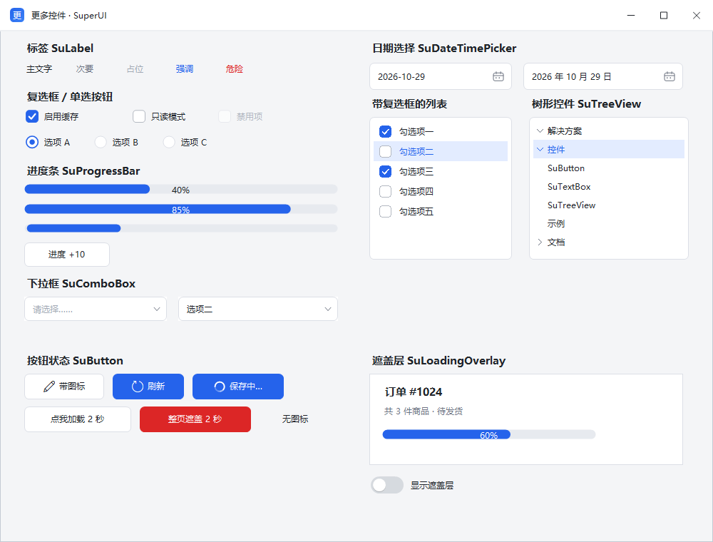

全部沿用同一套视觉：圆角、`Surface` 底、`Border` 描边、聚焦主色、`PrimarySoft` 选中。
演示里点总览页的「更多控件」按钮，或用 `--page=gallery` 启动，就停在这一页（和左侧菜单里的「更多控件」是同一页）。

### SuLabel

```csharp
var hint = new SuLabel { Text = "共 12 条记录", Tone = SuLabelTone.Secondary, Location = new Point(x, y) };
```

`Tone`：`Primary` / `Secondary` / `Placeholder` / `Accent` / `Danger`；默认 `AutoSize`，也支持 `AutoEllipsis` / `TextAlign`。
自己设置 `Font` / `ForeColor` 后主题不再覆盖。

### SuCheckBox / SuRadioButton

```csharp
var remember = new SuCheckBox { Text = "记住我", Checked = true };
var planA = new SuRadioButton { Text = "按月付费", Checked = true };   // 同容器自动互斥
```

* 圆角方框 + 对勾 / 圆形指示器 + 内点，悬停过渡、聚焦光环、`Space` 切换、按文字自动尺寸。
* `SuRadioButton` 勾选时自动取消同一父容器内的其它单选按钮（`Exclusive = false` 可关闭）。
* 公共属性：`Checked`、`BoxSize`、`LabelGap`；事件 `CheckedChanged`。

### SuProgressBar

```csharp
var p = new SuProgressBar { Value = 40, ShowText = true, Bounds = new Rectangle(x, y, 440, 14) };
p.IsIndeterminate = true;               // 不确定模式：圆角条来回滑动
p.BarColor = Color.FromArgb(0x16, 0xA3, 0x4A);   // 可选自定义色
```

`Value` 变化走 200ms 缓动；`Minimum / Maximum / ShowText / Radius` 可调；事件 `ValueChanged`。

### SuComboBox

```csharp
var combo = new SuComboBox { PlaceholderText = "请选择……", Bounds = new Rectangle(x, y, 200, 38) };
combo.Items.AddRange(new object[] { "选项一", "选项二", "选项三" });
combo.SelectedIndex = 1;
```

字段完全自绘（圆角、悬停/聚焦描边、占位符、箭头），下拉列表项由 `OnDrawItem` 按主题绘制
（选中 `PrimarySoft` + 主色文字）。下拉弹层本身的边框仍由系统绘制。

### SuDateTimePicker

```csharp
var date = new SuDateTimePicker
{
    Value = DateTime.Today,
    DisplayFormat = "yyyy 年 MM 月 dd 日",
    Bounds = new Rectangle(x, y, 200, 38),
};
date.ValueChanged += (_, _) => Reload(date.Value);
```

自绘字段 + 日历按钮，弹层是主题化过的 `MonthCalendar`（标题栏用主色、日期用主/次文字色）。
`MinDate` / `MaxDate`、`OpenCalendar() / CloseCalendar()`、`↑ ↓` 逐日调整、`Enter / Space` 打开。

### SuCheckedListBox

```csharp
var list = new SuCheckedListBox { Bounds = new Rectangle(x, y, 200, 200) };
list.SetItems("勾选项一", "勾选项二", "勾选项三");
list.SetItemChecked(0, true);
list.ItemCheck += (_, e) => Debug.WriteLine($"{e.Index} -> {e.NewValue}");
```

复选框由控件自己维护并绘制（不依赖原生 `CheckedListBox` 的绘制模式，避免被系统重置），
所以深浅色一致。`Items`、`CheckedIndices`、`GetItemChecked / SetItemChecked / ToggleItem`、
`CheckAll / UncheckAll`、`CheckOnClick`、`ItemCheck`、`SelectedIndexChanged`。

### SuTreeView

```csharp
var tree = new SuTreeView { Bounds = new Rectangle(x, y, 224, 200) };
var root = tree.AddNode("解决方案", null, expanded: true);
var controls = tree.AddNode("控件", root, expanded: true);
tree.AddNode("SuButton", controls);
tree.SelectedNode = controls;
```

`DrawMode = OwnerDrawAll`：折叠箭头、行底色、选中/悬停、文字全部自绘；`Nodes`、`SelectedNode`、
`AfterSelect / AfterExpand / AfterCollapse / NodeMouseClick`、`AddNode / ExpandAll / CollapseAll`。
滚动条仍由系统绘制。

| 控件 | 关键成员 |
| --- | --- |
| `SuLabel` | `Tone` |
| `SuCheckBox` / `SuRadioButton` | `Checked`、`CheckedChanged`、`BoxSize`、`LabelGap`、`Exclusive`(单选) |
| `SuProgressBar` | `Value`、`Minimum`、`Maximum`、`IsIndeterminate`、`ShowText`、`BarColor`、`TrackColor` |
| `SuComboBox` | `PlaceholderText`、`Items`、`SelectedIndex`、`Radius` |
| `SuDateTimePicker` | `Value`、`DisplayFormat`、`MinDate`、`MaxDate`、`IsDropDownOpen` |
| `SuCheckedListBox` | `Items`、`CheckedIndices`、`GetItemChecked`、`SetItemChecked`、`CheckAll` |
| `SuTreeView` | `Nodes`、`SelectedNode`、`AddNode`、`ExpandAll`、`ItemHeight` |

## 九、遮盖层 SuLoadingOverlay


```csharp
// 方式一：静态快捷方式（内部按控件缓存一个遮罩实例）
SuLoadingOverlay.Show(this, "正在加载数据…");
SuLoadingOverlay.Hide(this);

// 方式二：持久引用，适合反复显隐
var overlay = SuLoadingOverlay.For(myPanel);
overlay.ShowLoading("保存中…");
overlay.HideLoading();
if (overlay.IsLoading) { /* ... */ }
```

实现要点：

* **铺满目标控件**（`Dock = Fill`）并置于最上层，鼠标事件自然被它接住；
  键盘 / 滚轮用 `IMessageFilter` 按句柄树拦截，目标区域内的输入框不会在遮罩下继续接受输入。
* **半透明遮罩能透出内容**：显示时先用 `DrawToBitmap` 把目标区域截成位图，绘制时「先画快照、再叠半透明遮罩」，
  所以盖住的内容仍然可见（而不是一块纯色）。目标尚无句柄时会延迟到可见 / 句柄创建后再补拍。
* **旋转指示器**：底环 + 主弧 + 两段递减透明度尾迹，30fps；`SuSpinner` / `SuSpinnerAnimator` 可复用于其它控件。
* **入场淡入**（140ms），`ShowCard = false` 可去掉指示器后面的圆角卡片；`ScrimColor` 可自定义遮罩色。

| 属性 | 默认 | 说明 |
| --- | --- | --- |
| `LoadingText` | `加载中…` | 提示文字 |
| `SpinnerSize` / `SpinnerThickness` | `34` / `3.2` | 指示器尺寸 / 线宽 |
| `ScrimColor` | `null` | 遮罩色，`null` 由主题背景推导（深色约 78% 不透明） |
| `ShowCard` | `true` | 指示器后面是否画圆角卡片 |
| `IsLoading` | — | 只读，当前是否在加载 |
| `RefreshBackdrop()` | — | 内容变化后重拍遮罩底图 |

## 十、扩展：新增一个主题控件

```csharp
public class SuBadge : SuControlBase        // 基类已处理双缓冲 / 主题订阅 / 字体
{
    protected override void ApplyTheme()    // 主题变化时被调用
    {
        base.ApplyTheme();
        BackColor = SuBackdrop.Resolve(this);
    }

    protected override void OnPaint(PaintEventArgs e)
    {
        SuDraw.SetupQuality(e.Graphics);
        // 全量铺底，再画圆角内容（避免缓冲池残留）
        using (var bg = new SolidBrush(BackColor)) e.Graphics.FillRectangle(bg, ClientRectangle);
        var rect = new RectangleF(0.5f, 0.5f, Width - 1f, Height - 1f);
        using var path = SuDraw.RoundedRect(rect, Theme.Radius);
        using var brush = new SolidBrush(Theme.PrimarySoft);
        e.Graphics.FillPath(brush, path);
    }
}
```

基类注册/注销主题订阅、处理字体来源，`SuDraw` 提供圆角路径与颜色混合工具，
`SuBackdrop.Resolve` 用来在没有透明背景的前提下取到「控件身后的颜色」。

## 十一、实现要点（也是踩过的坑）

1. **不用 WinForms 透明背景**。`BackColor = Transparent` 的自绘控件叠在其它子控件上时，
   WinForms 会复读父容器像素，出现内容串色（例如按钮边框上出现隔壁按钮的红色）。
   现在控件用「父容器实色 + 圆角内填充」实现视觉上的透明，`SuBackdrop` 负责解析底色。
2. **圆角外区域必须显式铺底**。双缓冲缓冲池复用时不清理上一帧像素，
   圆角路径之外的 1~2 像素会残留别的控件内容；每个自绘控件的 `OnPaint` 先整块铺底色。
3. **字体同步不要随手 Dispose**。`Font.Equals` 是「按属性相等」，属性一致时 WinForms 会沿用旧实例，
   此时释放旧字体会让后续 `Font.Height` 抛 `Parameter is not valid`；`SuFontSync` 会先判断实例是否被沿用。
4. **子控件会挡住窗体的命中测试**。子控件铺满客户区时窗口收不到边缘的 `WM_NCHITTEST`，缩放就失效；
   所以内容区用 `DisplayRectangle` 收进标题栏与缩放热区之内，边缘那圈像素留给窗体自己命中，
   标题栏则把拖动 / 上边缘缩放交给系统移动循环。
5. **不要用固定 Padding 去让内容避开标题栏**。标题栏高度可能被 `TitleBarHeight` 或主题改变，
   用 `DisplayRectangle` 重写 + `PerformLayout()` 才能让 `Dock` / `Anchor` 的子控件跟着一起让位。
6. **`CheckedListBox` 的 `DrawMode` 会被重置**。实测在控件初始化后 `DrawMode` 又变回 `Normal`、`ItemHeight` 回到 18，
   导致自绘完全不生效（还漏出系统的蓝色选中条与白底复选框）。现在的 `SuCheckedListBox` 改用普通 `ListBox`
   + 自己维护勾选集合与复选绘制，行为可控。
7. **`Label` 的 `AutoSize` 默认是 false**。`SuLabel` 在构造函数里显式打开，否则多个标签会各自占 100px 宽，
   互相用不透明底色盖住对方（本次就踩了：只有第一个标签可见）。
8. **`ComboBox` 会自己画字段**。仅设置 `UserPaint` 不够，还要在 `WndProc` 收到 `WM_PAINT` 后用
   `CreateGraphics()` 再整体覆盖一次，字段才会变成主题外观。
9. **`Visible` 的可见性是被父容器带出来的**。遮罩层在父容器还没显示时 `Visible = true` 会触发一次
   `VisibleChanged`，此时"有效可见性"仍是 false——早期的收尾逻辑在这里把加载状态重置了，导致遮罩显示但状态丢了。
   现在只在"父容器已可见或没有父容器"时才做隐藏收尾，并且在构造函数最后才设置 `Visible`，
   保证 `OnVisibleChanged` 触发时 `_spinner` / `_fade` 已经初始化（否则构造期就 NRE）。
10. **半透明遮罩要先截快照**。子控件之间不会互相合成，直接画 50% 透明的遮罩只会得到一块纯色；
    显示时用 `DrawToBitmap` 把目标区域拍成位图、绘制时先铺快照再叠遮罩，才能"透出被盖住的内容"。
11. **`TextFormatFlags` 的水平位互斥**。把 `TextFormatFlags.Left` 直接 OR 到已经含 `HorizontalCenter` 的 flags 上，
    `DT_CENTER` 依旧生效，文字会被居中到「图标右侧那段剩余区域」——实测 150px 宽的按钮里文字右偏 15px。
    现在分两条路：没有图标就按 `TextAlign` 在整块里对齐（像素级居中），有图标才把图标与文字当成一组居中、文字只用 `Left`。

## 十二、表格 SuTable


```csharp
var table = new SuTable
{
    Dock = DockStyle.Fill,
    ShowCheckBoxes = true,                        // 最左侧复选框列（表头三态全选）
    SelectionMode = SuTableSelectionMode.Multi,   // None / Single / Multi
    RowHeight = 36,
};

// 列宽：> 0 固定像素；<= 0 自适应（平分剩余宽度）
table.Columns.Add(new SuTableColumn("编号", 72) { Align = SuTableAlign.Right, Property = "Id" });
table.Columns.Add(new SuTableColumn("姓名", 104) { Property = "Name" });
table.Columns.Add(new SuTableColumn("邮箱", -1) { Property = "Email" });
table.Columns.Add(new SuTableColumn("金额", 112) { Align = SuTableAlign.Right, Property = "Amount", Format = "N2" });
table.Columns.Add(new SuTableColumn("状态", 76)
{
    Align = SuTableAlign.Center,
    Getter = row => row.Item is User user && user.Active ? "启用" : "停用",   // 自定义取值优先级最高
});
table.Columns.Add(new SuTableColumn("最后登录", 148) { Property = "LastLogin", Format = "yyyy-MM-dd HH:mm" });

// 两种数据源：实体对象（配 Property / Getter）或二维单元格数组（按列序号取值）
table.SetDataSource(users);                                   // IEnumerable<T>
table.SetRows(new[] { new object?[] { 1, "张三", "a@b.c" } });  // 或者直接给单元格
table.AddRow(2, "李四", "d@e.f");                              // 追加一行

table.SelectionChanged += (_, _) => Debug.WriteLine($"{table.SelectedRows.Count} 行选中");
table.RowActivated += (_, e) => Debug.WriteLine($"双击第 {e.RowIndex + 1} 行");
table.CellClick += (_, e) => Debug.WriteLine($"{e.Column?.Header} / 第 {e.RowIndex + 1} 行");
table.Sorted += (_, e) => Debug.WriteLine($"{e.Column?.Header} {(e.Ascending ? "升序" : "降序")}");
```

能力清单：

* **表头**：主题浅底 + 分隔线，点击排序（同列升/降切换、换列从头升序），排序列文字与箭头用主色；
  单列 `Sortable = false` 可关掉排序，`SortBy(col, asc)` / `ToggleSort(col)` / `ClearSort()` 也可代码驱动。
* **行状态**：斑马纹（`ZebraStripes`）、行分隔线（`ShowRowLines`）、悬停淡入（主色浅底叠一半）、
  选中（`PrimarySoft` 底 + 主色文字）、禁用行（`SuTableRow.Enabled = false`）整体转灰。
* **复选框列**：`ShowCheckBoxes`，表头是三态（全选 / 半选 / 未选），`CheckAll()`、`CheckedChanged`，空格键切换当前行。
* **虚拟化行绘制**：只画可见区间（行数上万也只画一屏），滚动、选中、命中测试都按行号换算，不创建子控件。
* **滚动条**：自绘细滑块，滚轮（3 行/格）、`Shift + 滚轮` 横向、拖拽滑块、点轨道翻页；`EnsureVisible(index)` / `ScrollTo(x, y)`。
* **列宽**：拖表头右边界改宽（光标变 `SizeWE`），双击边界按内容自适应，`AutoSizeColumns()` 全表自适应；
  没有自适应列时最后一列吃掉剩余宽度（`StretchLastColumn`），列总宽超出可视宽度时自动出现横向滚动条。
* **键盘**：`↑ ↓` / `PgUp PgDn` / `Home End` 移动选中并自动滚动，`Ctrl + A` 全选，`Space` 勾选，`Enter` 触发 `RowActivated`。
* **数据帮助方法**：`Rows`（当前显示顺序）、`RowCount`、`SelectedRow` / `SelectedIndex` / `SelectedRows`、
  `SelectIndex()` / `SelectAll()` / `ClearSelection()`、`RefreshData()`、`RemoveRow()`、`ClearRows()`。
* **命中测试**：`RowIndexAt(Point)` / `ColumnIndexAt(Point)`，配合 `CellClick` 做右键菜单、单元格操作都很直接。

主要属性：

| 属性 | 默认 | 说明 |
| --- | --- | --- |
| `Columns` | 空 | 列集合（`SuTableColumn`：`Header`/`Width`/`Align`/`Sortable`/`Format`/`Property`/`Getter`/`Visible`） |
| `RowHeight` / `HeaderHeight` | `36` / `38` | 行高 / 表头高度 |
| `CellPadding` | `12` | 单元格左右内边距 |
| `ShowHeader` / `ZebraStripes` / `ShowRowLines` | `true` | 表头 / 斑马纹 / 行分隔线 |
| `ShowCheckBoxes` | `false` | 最左侧复选框列（宽 38px） |
| `SelectionMode` | `Single` | `None` / `Single` / `Multi`（Ctrl 追加、Shift 区间） |
| `StretchLastColumn` | `true` | 没有自适应列时，最后一列吃掉剩余宽度 |
| `EmptyText` | `暂无数据` | 无数据时的占位文字 |
| `Radius` | `-1` | 圆角，`-1` 跟随主题 |
| `SortColumnIndex` / `SortAscending` | `-1` / `true` | 当前排序列与方向（只读） |
| `FirstVisibleRow` / `HasVerticalScroll` / `HasHorizontalScroll` | — | 只读，滚动状态 |

实现要点：

1. **三趟收敛算布局**。纵向滚动条会占用宽度、横向滚动条会占用高度，两者互相影响：
   先假设都没有，算出列宽 → 判断要不要纵向条 → 用扣掉纵向条的宽度再算列宽 → 判断要不要横向条，
   最多迭代三次就稳定，避免"滚动条一出现就来回抖"。
2. **排序不改原始顺序**。`_rows` 保持添加顺序，`_view` 是排序后的显示顺序（`OrderBy` 稳定排序，同值保持原顺序）；
   所以 `ClearSort()` 能精确回到添加顺序，选中态挂在行对象上（`SuTableRow.IsSelected`），排序后不会错位。
3. **单元格取值三级回退**。`Getter`（最灵活）→ `Property`（反射，按 `(Type, 属性名)` 缓存 `PropertyInfo`）→
   `row.Cells[列序号]`；格式化统一走 `IFormattable`，所以 `Format = "N2"` / `"yyyy-MM-dd"` 直接生效。
4. **虚拟化绘制要夹住裁剪区**。`TextRenderer` 走 GDI，只有把 `SetClip(数据区)` 和单元格矩形都收进可视区，
   滚动时行文字才不会溢出到表头或边框外。
5. **圆角外框与像素对齐**。外框 1px 画在 `0.5f` 偏移上，行分隔线画在 `行顶 + 0.5f`，
   在 `AntiAlias` 下才是清晰的一条线而不是两条半透明灰线。

## 十三、分页 SuPagination

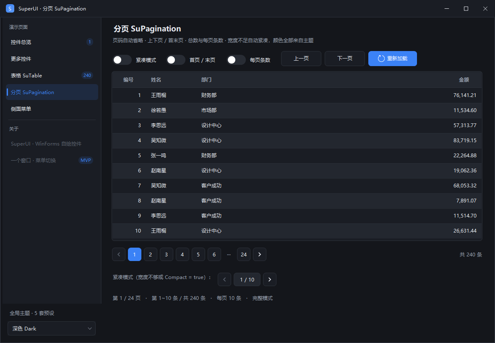

```csharp
var pager = new SuPagination
{
    Dock = DockStyle.Bottom,
    Height = 40,
    TotalCount = 240,             // 总条数：页数 = ceil(TotalCount / PageSize)
    PageSize = 10,                // 每页条数
    ShowTotal = true,             // 右侧「共 240 条」
    ShowFirstLast = false,        // 需要 « / » 时打开
    ShowPageSizeSelector = false, // 打开后右侧多一个「10 条/页」下拉（内置 SuComboBox）
};

pager.PageChanged += (_, e) =>
{
    // e.OldPage / e.NewPage / e.PageCount / e.TotalCount / e.ByUser
    LoadPage(e.NewPage, pager.PageSize);
};
pager.PageSizeChanged += (_, _) => LoadPage(pager.Page, pager.PageSize);

// 代码翻页：都会被夹取到 1..PageCount，同一页不会重复触发事件
pager.GoToPage(5);
pager.NextPage();
pager.PreviousPage();
pager.FirstPage();
pager.LastPage();
```

能力清单：

* **页码自动省略**：首尾始终可见、中间按当前页开窗，`⋯` 单独占一个槽位；只跳一个数字时直接画出那个数字，
  不画省略号（`1 2 3 4 5 6 ⋯ 24` 与 `1 ⋯ 48 49 50 51 52 ⋯ 100` 是同一套逻辑）。
  `MaxPageButtons` 是数字按钮上限（默认 7），实际数量还会按可用宽度继续收窄。
* **紧凑模式**：宽度放不下（或 `Compact = true`）时自动切成 `‹ 1 / 24 ›`，塞进窄卡片、弹窗底部也不会挤爆；
  `IsCompact` 只读告诉你当前是不是紧凑态。
* **导航与状态**：`ShowPrevNext`（‹ ›）、`ShowFirstLast`（« »）；首页时上一页置灰、末页时下一页置灰；
  悬停淡入、按下有底色、当前页是主色实心块，聚焦时当前页内部再套一圈光晕。
* **总数与每页条数**：`ShowTotal`（模板 `TotalFormat`，默认 `共 {0} 条`）、
  `ShowPageSizeSelector`（按需创建内置 `SuComboBox`，候选值来自 `SetPageSizeOptions(...)`，模板 `PageSizeFormat`）。
* **事件**：`PageChanged`（带 `ByUser`：点击 / 键盘为 true，程序设值与"数据变少导致收页"为 false）、`PageSizeChanged`。
* **键盘**：`← →` / `PgUp PgDn` 翻页，`Home End` 首末页，`Tab` 聚焦后即可操作。
* **只读状态**：`PageCount`、`IsCompact`、`PageSizeOptions`、`GetPageSequence()`（当前页码序列，`-1` 表示省略号，
  服务端分页想照抄这份页码时直接用）。

主要属性：

| 属性 | 默认 | 说明 |
| --- | --- | --- |
| `Page` / `PageSize` / `TotalCount` | `1` / `10` / `0` | 当前页 / 每页条数 / 总条数（页数由此换算） |
| `PageCount` | — | 只读，`ceil(TotalCount / PageSize)`，至少 1 |
| `MaxPageButtons` | `7` | 数字按钮数量上限（含首尾） |
| `ShowPrevNext` / `ShowFirstLast` | `true` / `false` | ‹ › / « » |
| `ShowTotal` / `TotalFormat` | `true` / `共 {0} 条` | 右侧总数文字 |
| `ShowPageSizeSelector` / `PageSizeFormat` | `false` / `{0} 条/页` | 右侧每页条数下拉 |
| `Compact` / `AutoCompact` / `IsCompact` | `false` / `true` / — | 强制紧凑 / 自动紧凑 / 当前是否紧凑 |
| `ItemWidth` / `ItemHeight` / `Gap` | `32` / `32` / `6` | 按钮尺寸与间距 |
| `Radius` | `-1` | 圆角，`-1` 跟随主题 |
| `PageTextFormat` | `{0} / {1}` | 紧凑模式文字模板（当前页 / 总页数） |

实现要点：

1. **先去占位，再放页码**。右侧的总数文字与每页条数下拉用「从右往左」占位，剩下的宽度才折算成页码槽位；
   `slots` 不足 5 就切紧凑模式——所以窄容器里永远不会出现半个按钮或溢出到控件外。
2. **页码开窗算法**。`pageCount <= maxButtons` 时全画；否则中间窗口取
   `start = clamp(cur - (window-1)/2, 2, pageCount-1-(window-1))`，两端各留一个省略号槽位，
   再把「`start == 2`」「`end == pageCount-1`」这种只差一个数字的情况吸附成实际页码。
3. **每页条数下拉是懒创建的**。`ShowPageSizeSelector` 为 true 时才 `Controls.Add` 一个 `SuComboBox`，
   关掉时移除但保留实例；`PageSize` 与下拉选项双向同步时用 `_syncingCombo` 挡住重入（否则会自己触发自己）。
4. **页号只有一个真源**。`TotalCount` / `PageSize` 变化后统一走一次收页，收页触发的事件带 `ByUser = false`，
   页面代码据此区分「用户翻页」和「数据变少」。

## 十四、消息弹窗 SuMessageBox

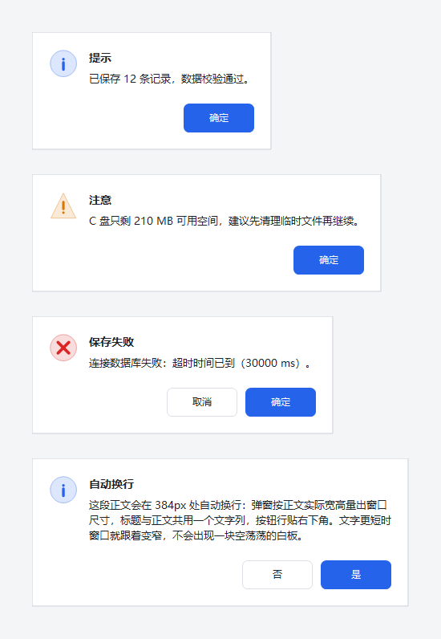

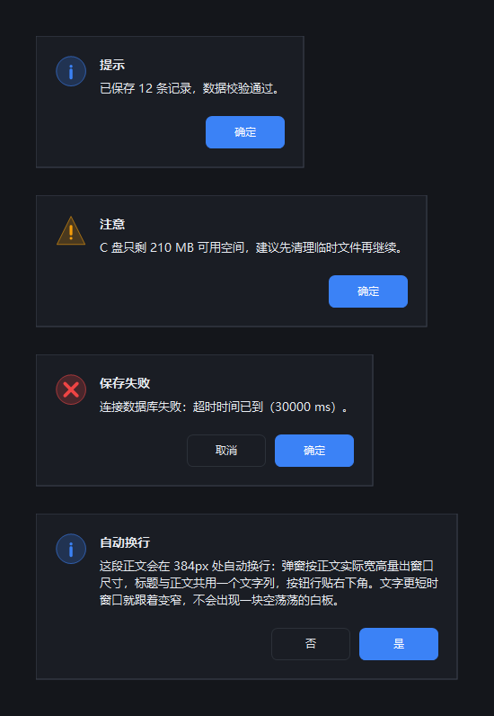

```csharp
using SuperUI.Forms;

// 三种语义，一行一个
SuMessageBox.Info("已保存 12 条记录。");
SuMessageBox.Warning(this, "C 盘只剩 210 MB 可用空间，建议先清理临时文件。", "磁盘空间不足");
SuMessageBox.Error(this, "连接数据库失败：超时时间已到（30000 ms）。", "保存失败");

// 异常对象直接扔进去：标题默认取异常类型名，正文取 Message
try { Save(); }
catch (Exception ex) { SuMessageBox.Error(ex, this); }

// 是 / 否确认：选「是」返回 true
if (SuMessageBox.Confirm(this, "确定要删除选中的 3 行吗？", "删除确认"))
{
    Delete();
}

// 需要「确定 / 取消」或自定义标题、按钮组合时用 Show
var result = SuMessageBox.Show(
    "此操作会覆盖 3 个已存在的文件，是否继续？",
    SuMessageBoxKind.Warning,
    "覆盖确认",
    SuMessageBoxButtons.OkCancel,
    this);
```

| 方法 | 说明 |
| --- | --- |
| `Info(message, title = null, owner = null)` | 信息提示（主色 `i` 图标），只有「确定」 |
| `Warning(...)` | 警告（琥珀色三角 `!`），只有「确定」 |
| `Error(...)` | 错误（危险色 `×`），只有「确定」 |
| `Error(Exception, owner = null, title = null)` | 异常 → 错误弹窗（正文 `ex.Message`，标题异常类型名） |
| `Confirm(message, title = null, owner = null)` | 是 / 否，返回 `bool` |
| `Show(message, kind, title, buttons, owner)` | 通用入口，返回 `DialogResult` |
| `(owner, message, title)` 重载 | 每个快捷方法都有一个「父窗口写在第一个参数」的版本 |

标题留空时按语义取默认文案：`提示` / `注意` / `错误`。传了 `owner` 就居中于 owner，不传则落在屏幕中央。

### 遮罩：要不要把父窗口压暗

默认会在宿主窗口上盖一层遮罩：**整窗（含标题栏）一起压暗**、和卡片同时淡入、关窗立刻撤掉。
没有 owner（弹窗自己落在屏幕中央）时无处可盖，自动不显示。

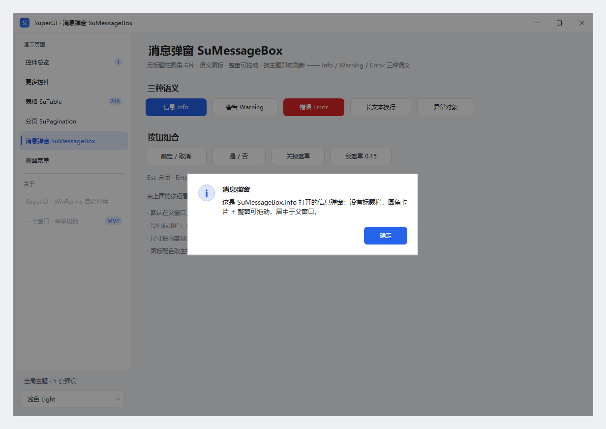

```csharp
// 静态入口：有 owner 默认就带遮罩；不想遮就传 scrim: false
SuMessageBox.Show("这次不压暗背后的窗口。", owner: this, scrim: false);

// 直接 new：三个属性分开调
using var box = new SuMessageBoxDialog
{
    Kind = SuMessageBoxKind.Info,
    Message = "背后还看得清，只做一点点区分。",
    ShowScrim = true,                      // 默认 true
    ScrimOpacity = 0.15f,                  // 0 = 不变暗，1 = 全黑；默认 0.45
    ScrimColor = Color.Black,              // 默认黑
    ScrimHost = this,                      // 不设就自动取 Owner
};
box.ShowDialog(this);
```

| 属性 | 默认 | 说明 |
| --- | --- | --- |
| `ShowScrim` | `true` | 是否在宿主窗口上盖遮罩；运行时改动会立刻挂上 / 撤掉 |
| `ScrimOpacity` | `0.45` | 压暗程度（0..1）。深色主题下喜欢更明显的可以调到 0.55~0.6 |
| `ScrimColor` | `Color.Black` | 遮罩颜色 |
| `ScrimHost` | `null` | 遮罩挂在哪个控件上；`null` = 自动取 `Owner`（`SuMessageBox.Show(...)` 会把 owner 填进来） |

遮罩期间宿主窗口是模态的：点不到背后的控件，只有弹窗自己的按钮和工作区可用。

也可以直接 new 一个窗口自己摆布（`SuMessageBoxDialog : SuBorderlessForm`）：

```csharp
using var box = new SuMessageBoxDialog
{
    Kind = SuMessageBoxKind.Warning,
    Text = "磁盘空间不足",
    Message = "C 盘只剩 210 MB，清理后再试。",
    ButtonSet = SuMessageBoxButtons.OkCancel,
};
if (box.ShowDialog(this) == DialogResult.OK) { Retry(); }
```

| 属性 | 默认 | 说明 |
| --- | --- | --- |
| `Kind` | `Info` | `Info` / `Warning` / `Error`，决定图标形状与配色（`Primary` / `Warning` / `Danger`） |
| `ButtonSet` | `Ok` | `Ok` / `OkCancel` / `YesNo`（最后一个按钮贴右下角，且是默认按钮） |
| `Message` | `""` | 正文，支持 `\r\n` 换行，超过 384px 自动折行并撑高窗口 |
| `Text` | 按语义 | 窗口标题，同时也是卡片标题（`提示` / `注意` / `错误`） |
| `ShowScrim` / `ScrimOpacity` / `ScrimColor` / `ScrimHost` | `true` / `0.45` / 黑 / `null` | 遮罩开关、压暗程度、颜色、挂在哪个控件上 |
| `TitleFontSize` / `BodyFontSize` | 主题 +1.5 / +0.5 | 只读，跟随主题字号推算 |

实现要点：

1. **尺寸是量出来的，不是写死的**。标题按单行、正文按 384px 上限折行（`TextRenderer.MeasureText` + `WordBreak`），
   两者取较大宽度算客户区，再把 `MinimumSize` 与 `MaximumSize` 都设成这个尺寸锁死；
   所以短文案是一张小卡片，长文案自动变宽变高，不会出现「一半空白」或「文字被截断」。
2. **没有标题栏也能拖动**。窗口隐藏标题栏后，拦截 `WM_NCHITTEST`：客户区里不在按钮上的点一律返回 `HTCAPTION`，
   交给系统的原生移动循环；同时吞掉 `WM_NCLBUTTONDBLCLK`，双击不会把卡片最大化。
3. **按钮必须留出 `HTCLIENT`**。命中测试落在按钮矩形里时照常返回 `HTCLIENT`，否则按钮会被当成标题栏，点不动。
4. **`AutoScaleMode = None`**。留白、图标、按钮尺寸都自己按 `DeviceDpi` 换算，关掉自动缩放，避免被放大两次。
5. **淡入结束后要回到 `Opacity = 1`**。`Opacity < 1` 时窗口是分层窗口（拿不到 DWM 圆角与投影），
   入场动画（120ms）结束后把不透明度放回 1，圆角与投影自动恢复。
6. **`Resizable = false` 会把 `MaximumSize` 锁成当时的尺寸**。换主题后字号变了、窗口要变高，
   所以每次重排都先解锁 `MinimumSize / MaximumSize`、改完 `ClientSize` 再锁回去。
7. **Esc / Enter 都有落点**。`AcceptButton` 是确认类按钮；只有一个「确定」时它同时兼任 `CancelButton`，
   Esc 也能关窗（和系统 `MessageBox` 的行为一致）。
8. **遮罩要先拍快照再叠色**。WinForms 的子控件之间不会互相合成，直接给遮罩刷半透明底色只会得到一块纯色板；
   遮罩层显示前先用 `DrawToBitmap` 把宿主当前画面拍下来，绘制时「先铺快照、再叠半透明」，
   所以背后的表格 / 菜单 / 侧栏依旧看得见（和遮盖层 `SuLoadingOverlay` 是同一套路）。
9. **遮罩不用 `Dock = Fill`**。`SuBorderlessForm.DisplayRectangle` 会把标题栏让出去，`Dock = Fill` 只盖内容区；
   改成手动铺满整个客户区，标题栏才会一起压暗（模态期间宿主本来就不接受操作，挡住标题栏也没关系）。
10. **关窗必须先撤遮罩**。模态结束时宿主立刻恢复可交互，遮罩要是还在，就是一块「点不动的盖子」：
    `OnFormClosed` 里撤一次、`Dispose` 里再兜一次，并且摘掉 `SizeChanged` 订阅。
11. **owner 要显式递给遮罩**。`ShowDialog(owner)` 不保证给 `Form.Owner` 赋值，
    所以 `SuMessageBox.Show(...)` 直接把 `owner as Control` 塞进 `ScrimHost`；自己 new 弹窗时按需指定。

## 十五、许可与后续

内部示例库，按需扩展。后续可以沿同一套主题继续加：`SuTabControl`、`SuCard`、`SuTooltip`、
`SuListBox`、`SuSlider` 等——只要颜色取自 `SuTheme`、继承 `SuControlBase`，就自动获得整站换肤能力。
